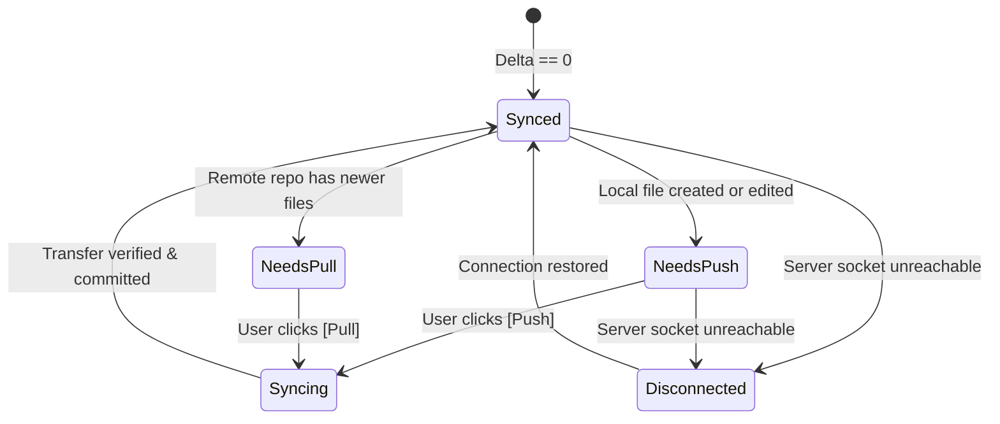

# MiniDrop: Single-User Remote Repository with Dynamic Status-Driven Action Button
## Final Architectural Plan & Implementation Specification

---

## 1. Executive Summary

This plan re-architects **MiniDrop** from an implicit background desktop synchronizer into an **Interactive, Single-User Remote Repository System** with a centralized **Live Status-Aware Smart Action Button**.

### Core Philosophy:
1. **Single-User Dedicated Remote Repository**: Eliminates multi-tenant / multi-client complexity in favor of a clean, dedicated master remote storage repository (`./storage/repo/`).
2. **Explicit On-Demand Control**: Instead of silent background sync, the user has full agency. The system continuously evaluates the synchronization difference between the local directory and the remote repository.
3. **The Single Smart Action Button**: A centralized user interface element that continuously fetches the backend state via a lightweight polling loop. The button automatically adapts its visual appearance, state, label, and click handler based on real-time filesystem differentials (e.g. `[✓ Up to Date]`, `[⬆ Push 2 Changed Files]`, `[⬇ Pull Remote Updates]`, `[⏳ Syncing 60%...]`, `[⚠ Server Offline]`).
4. **100% C-Powered Operating Systems Core**: Built strictly in C11 using native Linux POSIX APIs (Sockets, pthreads, OpenSSL SHA-256, atomic staging and `rename()`, directory traversal via `opendir`/`readdir`/`lstat`).

---

## 2. System Architecture

```
+-----------------------------------------------------------------------------------------+
|                                    USER INTERFACE                                       |
|                                                                                         |
|   Web Dashboard (http://localhost:8080)   OR   Interactive Terminal Dashboard           |
|                                                                                         |
|       +-------------------------------------------------------------------------+       |
|       |                                                                         |       |
|       |     [ ⬆ PUSH 2 FILES TO REMOTE REPO ]   <==== SMART DYNAMIC BUTTON      |       |
|       |                                               (Auto-adapts to status)   |       |
|       +-------------------------------------------------------------------------+       |
|                                                                                         |
|       [ Local Files (my_project/) ]                   [ Remote Repo (/storage/repo/) ]  |
|       ├── notes.txt (Modified)                        ├── notes.txt (v1)                |
|       ├── main.c (Synced)                             ├── main.c (v1)                   |
|       └── image.png (New)                                                               |
+-----------------------------------------------------------------------------------------+
                                      |
                     Polls /api/status (Every 1s)  |  Sends POST /api/action
                                      v
+-----------------------------------------------------------------------------------------+
|                          C BACKEND APPLICATION ENGINE                                   |
|                                                                                         |
|  1. Embedded HTTP / REST Micro-Service (Pure C POSIX Sockets):                          |
|     ├── GET  /             -> Serves sleek single-button UI dashboard                   |
|     ├── GET  /api/status   -> Computes delta, returns JSON { state, count, files }      |
|     └── POST /api/action   -> Triggers Push / Pull execution in background thread       |
|                                                                                         |
|  2. Diff & Metadata Comparison Engine:                                                  |
|     ├── Scans local folder (lstat, size, mtime, SHA-256)                                |
|     ├── Scans remote repo folder (SHA-256 manifest)                                     |
|     └── Evaluates Delta: Synced vs Local Ahead (Push) vs Remote Ahead (Pull)            |
|                                                                                         |
|  3. Reliable Network & Storage Engine:                                                  |
|     ├── Chunked TCP Streaming (64 KB chunks)                                            |
|     ├── OpenSSL EVP SHA-256 Cryptographic Verification                                  |
|     └── Atomic POSIX Staging (.tmp.<req_id> -> rename())                                |
+-----------------------------------------------------------------------------------------+
                                      |
                         TCP Socket Wire Transmission
                                      v
+-----------------------------------------------------------------------------------------+
|                           REMOTE REPOSITORY STORAGE                                     |
|                                                                                         |
|   Directory: ./storage/repo/ (Sandboxed, clean single-user repository tree)             |
+-----------------------------------------------------------------------------------------+
```

---

## 3. The Dynamic "Smart Button" State Machine

The button is driven by the backend delta evaluation. It transitions through the following distinct states:



### Button States Table:

| State | Visual Appearance | Color / Style | Action on Click |
| :--- | :--- | :--- | :--- |
| **`STATE_SYNCED`** | `[ ✓ Repository Up to Date ]` | Emerald Green (Disabled) | Inactive (No action needed) |
| **`STATE_NEEDS_PUSH`** | `[ ⬆ Push to Remote (N files) ]` | Vibrant Blue (Glowing) | Executes `handle_push()` to stream modified/new files to server |
| **`STATE_NEEDS_PULL`** | `[ ⬇ Pull from Remote (N files) ]` | Purple / Cyan | Executes `handle_pull()` to download remote updates |
| **`STATE_SYNCING`** | `[ ⏳ Syncing... X% ]` | Amber / Pulsing | Disabled while transfer is in progress |
| **`STATE_ERROR`** | `[ ⚠ Reconnect to Remote ]` | Crimson Red | Attempts reconnection & health check |

---

## 4. Technical Design & C Components

### A. Diff & Inventory Engine (`common/metadata.c`)
- **`repo_compute_diff(local_path, remote_path, out_diff)`**:
  - Recursively traverses both local directory and remote storage.
  - Computes OpenSSL SHA-256 hashes of all entries.
  - Builds a diff struct:
    ```c
    typedef enum {
        REPO_STATE_SYNCED = 0,
        REPO_STATE_NEEDS_PUSH,
        REPO_STATE_NEEDS_PULL,
        REPO_STATE_SYNCING,
        REPO_STATE_ERROR
    } repo_state_t;

    typedef struct {
        repo_state_t state;
        size_t pending_count;
        char pending_files[64][MINIDROP_MAX_PATH_LEN];
        uint64_t total_bytes;
        int progress_pct;
    } repo_diff_t;
    ```

### B. Action Handlers (`client/transfer.c`)
- **`repo_action_push()`**:
  - Scans files marked as new or modified locally.
  - Transmits via chunked 64 KB frames over TCP.
  - Server validates SHA-256 and atomically commits them into `./storage/repo/`.
- **`repo_action_pull()`**:
  - Downloads any files present in `./storage/repo/` that are missing or outdated locally.

### C. Embedded C Web / Status Server
- Pure C socket server built into the binary.
- Listens on `http://127.0.0.1:8080` (or specified port).
- Implements micro-endpoints:
  - `GET /`: Serves single-page HTML/CSS/JS dashboard.
  - `GET /api/status`: Returns JSON snapshot of current diff.
  - `POST /api/action`: Triggers `push` or `pull`.
- Zero external web servers or frameworks needed (Node.js/Python free).

### D. Dual Mode: CLI + Web UI
Users can operate either:
1. Via the Web Dashboard at `http://localhost:8080`.
2. Via standard Git-like terminal commands:
   ```bash
   ./bin/minidrop status   # Prints current diff
   ./bin/minidrop push     # Pushes local changes to remote
   ./bin/minidrop pull     # Pulls remote changes to local
   ./bin/minidrop ui       # Launches web dashboard with the smart button
   ```

---

## 5. Implementation Roadmap

### Phase 1: Storage & Diff Unification
- Configure single repository storage root (`./storage/repo/`).
- Implement `repo_compute_diff()` in `common/metadata.c` to categorize changes as `SYNCED`, `NEEDS_PUSH`, or `NEEDS_PULL`.

### Phase 2: Push & Pull Core Execution
- Wire `repo_action_push()` and `repo_action_pull()` into `client/transfer.c` with chunked transfer and OpenSSL verification.
- Expose direct CLI subcommands: `./bin/minidrop push` and `./bin/minidrop pull`.

### Phase 3: Embedded C HTTP & REST API Engine
- Implement a thread-safe micro HTTP request parser in C.
- Serve `/api/status` (JSON diff) and `/api/action` (Push/Pull trigger).

### Phase 4: Single-Button Frontend Dashboard
- Design a modern single-page dashboard.
- Place the central **Smart Dynamic Action Button**.
- Implement automatic 1-second status polling to dynamically morph the button text, color, and behavior.

### Phase 5: End-to-End Verification
- Test file creation, modification, and deletion against the smart button.
- Verify live button transition from `[✓ Synced]` $\to$ `[⬆ Push 1 File]` $\to$ `[⏳ Syncing]` $\to$ `[✓ Synced]`.
- Verify automated CLI tests pass.

